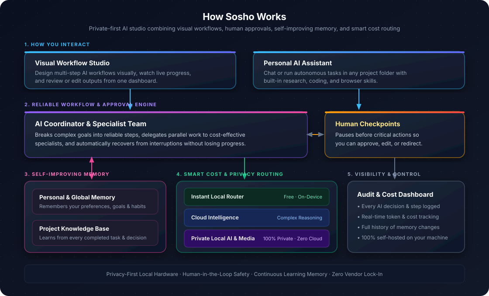

<div align="center">


# Sosho

**Local-first Artificial Intelligence studio, SQLite Write-Ahead Log workflow engine, two-tier memory system, and multi-model agent workspace.**

[](LICENSE)
[](compose.yaml)
[](packages/workflow-engine/src/engine.ts)
[](apps/studio/src/App.tsx)
[](docker/compose.langfuse.yaml)
[](bin/doctor.sh)

</div>

---

## How Sosho Works

<p align="center">
  
</p>

---

## Core Capabilities

### 1. Durable SQLite Workflow Engine and Sosho Studio

- **Typed Graph Validation (`packages/workflow-engine/src/schema.ts`):** Define workflows as versioned JavaScript Object Notation (JSON) files in `workflows/*.graph.json`. Supported node types are `agent`, `subagent`, `decision`, `tool`, `skill`, `checkpoint`, and `memory`. `validateGraph` checks Zod schemas, `entryNode` existence, edge endpoints, and branch or checkpoint conditions on save and before run start.
- **SQLite Write-Ahead Log (WAL) Directed Acyclic Graph (DAG) Engine (`packages/workflow-engine/src/engine.ts`, `store.ts`):** Runs inside the Studio server process with zero external workflow containers. Persists runs, step logs, state data, and paused checkpoints in `.pi/workflows/runs.sqlite`. Executes unconditional branches in parallel, waits at join nodes, recovers interrupted runs at startup, and fails cyclic runs with `max_steps_exceeded`.
- **Resource Queue Semaphores:** Enforces in-process concurrency caps across `cloud-io` (`8`), `local-gpu` (`1`), and `host-browser` (`2`) to protect graphics card memory and host Chrome tabs.
- **Real Activity Execution (`packages/workflow-engine/src/activities.ts`):** Calls `@sosho/llm` for pure Large Language Model (LLM) nodes. Runs `pi --print --no-session` for tool-capable `skill` nodes and skill-enabled `subagent` nodes. Submits and waits on async `yue2` jobs and downloads audio and ABC score files. Supports nested dot templates such as `{{result.summary}}`, per-node retries with exponential delay, and `AbortSignal.timeout`.
- **Visual Studio Editor (`apps/studio/`):** React Flow canvas on port `4100` connected to the Studio API on port `4101`. Provides editable forms for all seven node types, an edge condition editor, an `entryNode` selector, skills dropdowns, a recent runs list with cancel controls, Memory Explorer create and archive forms, and persistent run state over Server-Sent Events (SSE) with 15-second heartbeats.

### 2. Two-Tier Memory Engine

- **Global and Project Scopes (`packages/memory/src/store.ts`, `.pi/extensions/memory/`):** Stores personal preferences and playbooks in `~/.sosho/memory/` and repository architecture and session history in `<repo>/.pi/memory/`.
- **Atomic Storage and Race-Free Inbox Drain:** Writes every Markdown record and profile through a temporary file with `fsync` and atomic rename. Renames `inbox/events.jsonl` to a unique batch file before drain, deduplicates identical events by SHA-256 hash, and always refreshes `core/profile.md`. Captures all newly completed scratchpad tasks once on `session_shutdown`.
- **Secret Redaction Across Both Scopes:** Redacts OpenAI keys, Langfuse keys, Hugging Face tokens, Amazon Web Services access keys, GitHub tokens, JSON Web Tokens, Privacy-Enhanced Mail (PEM) private keys, bearer headers, and credential URLs in both `global` and `project` scopes.
- **Rebuildable SQLite FTS5 Index, Local Vectors, and Entity Graph:** Maintains a disposable `<memory-root>/index.sqlite` with `memories`, `memories_fts`, and `memory_entities`. Combines FTS5 BM25, local CPU `embeddinggemma` dense vectors (`127.0.0.1:8082`, zero graphics card memory) with automatic FTS5 fallback, single-hop entity graph recall (including multi-word entities), time decay, and `access_count` plus `last_accessed` rank tracking.

### 3. Shared LLM Client, Model Tiering, and Native Subagents

- **Shared `@sosho/llm` Package (`packages/llm/`):** Loads `.env` from the workspace and Sosho root. Resolves roles from `.pi/model-roles.json` and providers from `.pi/models.json`. Caches local health checks for 15 seconds, falls back automatically when a local server is offline, and emits Langfuse traces when Langfuse keys exist.
- **Native Pi Subagents (`.pi/extensions/subagents/`, `packages/llm/src/subagent-runtime.ts`):** Runs isolated `pi --print --no-session` child processes. Tracks depth via `SOSHO_SUBAGENT_DEPTH` (`MAX_DEPTH = 3`), enforces global per-tier semaphores so cloud tasks run in parallel while `local-uncensored` serializes to `1`, caps `stdout` and `stderr` at 2 megabytes each, and returns `isError: true` on failure.

| Role Tier | Model | Runtime Location | Purpose |
| :--- | :--- | :--- | :--- |
| `main` | `deepseek-ai/DeepSeek-V4.1-Flash-1017` | DeepInfra Cloud | Primary orchestrator and complex synthesis |
| `subagent` | `Qwen/Qwen3-32B` | DeepInfra Cloud | Parallel research, synthesis, and memory tasks |
| `subagent-code` | `Qwen/Qwen3-Coder-30B-A3B-Instruct` | DeepInfra Cloud | Code exploration, edits, and tests |
| `decision` | `Qwen3-1.7B` (Q4_K_M) | Local CPU (`:8081`, 0 VRAM) | Fast routing with automatic cloud fallback |
| `local-uncensored` | `Qwen3.6-35B-A3B` | Local GPU (`:8080`, `-np 1`) | Private local inference on host GPU |
| `embed` | `embeddinggemma-300M` (Q8_0) | Local CPU (`:8082`, 0 VRAM) | Local memory vector embeddings |

### 4. Local Music Generation (`yue2/`)

- **Zero Docker Socket Privilege:** `yue2-gateway` on `127.0.0.1:8021` releases `llama-cpp` graphics card memory through `POST http://llama-cpp:8080/models/unload` without `/var/run/docker.sock`.
- **Hardened Async Worker (`yue2/gateway/app.py`):** Runs `ffmpeg` FLAC conversion off the FastAPI event loop via `asyncio.to_thread`. Keeps `llama-cpp` unloaded across consecutive queued jobs until the queue drains. Computes recursive directory bytes in `prune_artifacts`. Uses `secrets.compare_digest` for bearer auth, requires `YUE2_API_KEY` when bound outside loopback, and enforces `MAX_PENDING` inside one database lock transaction.
- **CLI and Skill:** Install `yue2-music` via `make install-cli` or use `.pi/skills/yue2-music/SKILL.md`.

### 5. Security, Container Limits, and External Repositories

- **Studio Server Security (`apps/studio/server/index.ts`):** Restricts `Access-Control-Allow-Origin` to `http://127.0.0.1:4100` and `http://localhost:4100`. Requires `SOSHO_STUDIO_TOKEN` bearer authentication on all `POST`, `PUT`, and `DELETE` routes. Caps request bodies at 1 megabyte (`HTTP 413`), rejects invalid JSON (`HTTP 400`), and blocks path traversal in workflow IDs.
- **Langfuse Memory Limits (`docker/compose.langfuse.yaml`, `docker/clickhouse-memory.xml`):** Parameterizes all secrets via `.env` and caps container memory: `clickhouse` (`1g`), `langfuse-web` (`512m`), `langfuse-worker` (`512m`), `postgres` (`512m`), `minio` (`256m`), and `redis` (`256m`).
- **Isolated Model Mounts (`compose.yaml`):** Mounts each model directory separately for `llama-cpp`, `llama-decision`, and `llama-embed`.
- **External Repository Launcher (`bin/pi-launcher.sh`):** Symlinks `~/.local/bin/pi` to `bin/pi-launcher.sh`, mounts Sosho read-only at `/opt/sosho`, resolves extensions and skills in any external Git repository, and syncs compaction settings to the active default model `contextWindow`.

### 6. Modular Capability Skills (`.pi/skills/`)

Available skills: `social-x`, `github-scout`, `youtube-digest`, `libdocs`, `data-lab`, `creative-canvas`, `web-craft`, `security-lab`, `lean-proofs`, `sys-admin`, `dokobot`, and `yue2-music`.

---

## Repository Layout

| Path | Purpose |
| :--- | :--- |
| `packages/llm/` | Shared `@sosho/llm` client, health cache, Langfuse trace emitter, and subagent runtime helpers |
| `packages/memory/` | Two-tier Markdown plus SQLite FTS5, `embeddinggemma` vector, and entity graph memory engine |
| `packages/workflow-engine/` | Zod graph validator, activity runners, and SQLite WAL DAG workflow engine |
| `apps/studio/` | Sosho Studio API server (`:4101`) and React Flow visual editor (`:4100`) |
| `bin/` | `pi-launcher.sh`, `autotune.sh`, `doctor.sh`, and `chunk-read.sh` |
| `docker/` | `Dockerfile.pi`, `compose.langfuse.yaml`, `clickhouse-memory.xml`, and `Dockerfile.yue2-gateway` |
| `yue2/` | YuE2 gateway FastAPI service, pytest suite, and `generate.sh` CLI |
| `tests/` | Unified `run_tests.sh` automated test runner |
| `.pi/` | Pi settings, models, role tiers, extensions, and modular skills |

---

## Service Ports

| Port | Service | Scope |
| :--- | :--- | :--- |
| `8080` | `llama-cpp` (`Qwen3.6-35B-A3B`) | Local GPU model server |
| `8081` | `llama-decision` (`Qwen3-1.7B`) | Local CPU decision router |
| `8082` | `llama-embed` (`embeddinggemma-300M`) | Local CPU memory embedding server |
| `3000` | `langfuse-web` | Langfuse v4 UI and trace ingestion |
| `8021` | `yue2-gateway` | YuE2 async music generation API |
| `4100` | Sosho Studio UI | React Flow visual editor |
| `4101` | Sosho Studio API | REST API, SSE stream, and SQLite DAG engine |

---

## Quick Start

### Prerequisites

- **Node.js:** Version `20.18.0` or newer. Both Node 20 and Node 24 work via `tsx`.
- **Docker:** Docker Engine with Compose v2.
- **Python:** Python 3.11 or newer for YuE2 gateway tests.

### 1. Core Stack

```bash
cp .env.example .env   # Optional: set DEEPINFRA_API_KEY and SOSHO_STUDIO_TOKEN
make doctor            # Check Docker, Node, GPU, ports, and CLI links
make autotune          # Generate hardware-tuned .env while preserving custom keys
make install-cli       # Install pi and yue2-music symlinks into ~/.local/bin
make up                # Start llama-cpp (:8080) and Langfuse (:3000)
```

### 2. Optional Local CPU Models and Sosho Studio

```bash
# Start local CPU decision router (:8081) and embeddinggemma (:8082) with 0 GPU VRAM
make decision-up
make embed-up

# Install Node dependencies once
(cd packages/llm && npm install)
(cd packages/memory && npm install)
(cd packages/workflow-engine && npm install)
(cd apps/studio && npm install)

# Start Studio API + SQLite DAG engine (:4101) and Studio UI (:4100)
SOSHO_STUDIO_TOKEN=local-dev-token make studio-api
make studio-ui
```

Open `http://127.0.0.1:4100` and paste `SOSHO_STUDIO_TOKEN` into the top-bar token field to save workflows, start runs, approve checkpoints, and manage memory.

### 3. Interactive Terminal Agent (`pi`)

Run `pi` inside Sosho or any external Git repository:

```bash
cd ~/projects/my-app
pi
```

### 4. Automated Test Suite

Run all seven verification suites (TypeScript typechecks, `pi-sandbox` extension smoke tests, memory, LLM and subagents, workflow engine, Studio server, and YuE2 gateway pytest):

```bash
make test
```

---

## Make Commands

| Command | Description |
| :--- | :--- |
| `make doctor` | Run full host, GPU, Node, port, and CLI diagnostics |
| `make autotune` | Tune `.env` for host hardware and preserve custom keys |
| `make install-cli` | Install `pi` and `yue2-music` symlinks into `~/.local/bin` |
| `make up` | Start `llama-cpp` (`:8080`) and Langfuse v4 (`:3000`) |
| `make decision-up` | Start local CPU `Qwen3-1.7B` decision router (`:8081`) |
| `make embed-up` | Start local CPU `embeddinggemma` vector server (`:8082`) |
| `make music-up` | Start YuE2 music engine and gateway (`:8021`) |
| `make music-down` | Stop YuE2 music services |
| `make studio-api` | Start Sosho Studio API, SQLite DAG engine, and SSE server (`:4101`) |
| `make studio-ui` | Start Sosho Studio React Flow visual canvas (`:4100`) |
| `make test-memory` | Run two-tier memory unit tests |
| `make test` | Run all seven automated test suites |
| `make down` | Stop all containers across all Compose profiles |
| `make restart` | Restart `llama-cpp` |
| `make status` | Show Docker Compose container status |
| `make logs` | Stream logs for core services |

---

## Core Technical Pillars

Sosho stands on six technical pillars. Each pillar isolates a clear responsibility, enforces explicit safety limits, and exposes clean extension points.

### 1. Local-First Hybrid Model Routing (`@sosho/llm`)

- **Core design:** One shared client in `packages/llm/src/index.ts` resolves `.env` keys, `.pi/models.json` providers, and `.pi/model-roles.json` tiers for both interactive agents and workflow nodes.
- **Key guarantees:** Caches local health checks for 15 seconds, falls back from offline local servers to cloud providers automatically, and emits best-effort Langfuse generation traces whenever Langfuse keys exist.
- **Extensibility:** Add any OpenAI-compatible local or cloud provider in `.pi/models.json` and bind a new role tier in `.pi/model-roles.json` without code changes.
- **Primary use cases:** Fast zero-cost CPU routing on `decision`, private offline inference on `local-uncensored`, parallel cloud research on `subagent`, and deep synthesis on `main`.

### 2. Durable SQLite WAL DAG Workflow Engine (`@sosho/workflow-engine`)

- **Core design:** Runs an in-process Directed Acyclic Graph scheduler backed by `.pi/workflows/runs.sqlite` in Write-Ahead Log mode with zero external broker or database containers.
- **Key guarantees:** Validates every graph with Zod and static edge checks before save and run start. Executes unconditional branches concurrently, synchronizes join nodes, pauses cleanly on `approve` or `reject` checkpoints, recovers interrupted runs at startup, and fails cyclic loops with `max_steps_exceeded`.
- **Extensibility:** Author new workflows as JSON files in `workflows/*.graph.json` or in Sosho Studio. Add custom node types in `schema.ts` and wire their execution handlers in `activities.ts`.
- **Primary use cases:** Repeatable research pipelines, Human-in-the-Loop approval gates, scheduled memory consolidation, and multi-stage music or code generation pipelines.

### 3. Two-Tier Hybrid Memory System (`@sosho/memory`)

- **Core design:** Separates human-readable Markdown source files (`~/.sosho/memory` and `<repo>/.pi/memory`) from a disposable, rebuildable SQLite index (`index.sqlite`) that stores FTS5 full-text rows, `embeddinggemma` dense vectors, and entity links.
- **Key guarantees:** Writes files atomically via temporary file, `fsync`, and rename. Drains inbox events via atomic batch rename with SHA-256 deduplication. Redacts secrets in both global and project scopes. Tracks `access_count`, `last_accessed`, and bi-temporal supersede chains in `archive/` and `audit.jsonl`.
- **Extensibility:** Swap the local embedding endpoint via `SOSHO_EMBED_URL`, add new secret regex rules in `SECRET_PATTERNS`, or add custom memory types and entity extractors without migrating Markdown files.
- **Primary use cases:** Cross-project personal preferences, repository architecture memory, session task distillation, and fast sub-10-millisecond hybrid recall across hundreds of records.

### 4. Sandboxed Autonomous Agent Runtime and Subagents (`pi` + `.pi/extensions/`)

- **Core design:** Runs `pi` inside a reproducible `pi-sandbox:latest` container via `bin/pi-launcher.sh`, mounting Sosho read-only at `/opt/sosho` so every external Git repository inherits extensions, skills, and model configs cleanly.
- **Key guarantees:** Enforces `SOSHO_SUBAGENT_DEPTH` (`MAX_DEPTH = 3`), runs child processes with `--no-session`, applies module-level per-tier semaphores (`local-uncensored = 1` globally while cloud tiers run concurrently), caps `stdout` and `stderr` at 2 megabytes each, and propagates `isError` on failure.
- **Extensibility:** Drop new modular skills into `.pi/skills/<name>/SKILL.md` with deterministic helper scripts in `scripts/`, or add new Pi lifecycle extensions in `.pi/extensions/`.
- **Primary use cases:** Autonomous coding in any host Git repository, parallel codebase exploration, browser-assisted research via Dokobot, and script-backed batch automation.

### 5. VRAM-Safe Local Media and Model Orchestration (`compose.yaml` + `yue2/`)

- **Core design:** Isolates model directories per container, runs CPU-only helper models (`Qwen3-1.7B` and `embeddinggemma`) with zero graphics card memory, and coordinates exclusive GPU access between `llama-cpp` and `yue2-engine` over unprivileged HTTP model unload calls.
- **Key guarantees:** Removes `/var/run/docker.sock` from `yue2-gateway`, keeps `llama-cpp` paused across queued music jobs until the queue empties, runs `ffmpeg` FLAC encoding off the FastAPI event loop, prunes disk usage recursively, and enforces constant-time bearer auth plus atomic `MAX_PENDING` limits.
- **Extensibility:** Add new local `llama.cpp` profiles in `compose.yaml` with isolated read-only mounts, or submit music jobs from any workflow node or CLI script via `http://127.0.0.1:8021/v1/jobs`.
- **Primary use cases:** Single-GPU workstations with 8 gigabytes of Video Random Access Memory that run large local language models alongside local audio synthesis.

### 6. Security, Observability, and Automated Verification (`apps/studio/`, `docker/`, `tests/`)

- **Core design:** Pairs an always-on memory-capped Langfuse v4 telemetry stack (`:3000`) with a token-authenticated Studio API (`:4101`), an interactive React Flow editor (`:4100`), and a single fail-fast verification runner (`tests/run_tests.sh`).
- **Key guarantees:** Enforces strict container memory limits on ClickHouse, Postgres, MinIO, Redis, and Langfuse. Restricts Studio CORS to loopback UI origins, requires `SOSHO_STUDIO_TOKEN` on mutating endpoints, caps payloads at 1 megabyte, and rejects unsafe workflow IDs.
- **Extensibility:** Override any secret or port in `.env`, subscribe custom dashboards to `GET /api/events` SSE streams, and add new package checks to `tests/run_tests.sh`.
- **Primary use cases:** Full trace inspection in Langfuse, interactive graph editing with live node badges, safe local multi-service operation, and one-command regression testing via `make test`.
